<p align="center">
  
</p>

<h1 align="center">Incognide</h1>

<p align="center">
  <strong>Explore the unknown and build the future.</strong>
</p>

<p align="center">
  <a href="https://github.com/npc-worldwide/incognide/blob/main/LICENSE"></a>
  <a href="https://enpisi.com/incognide"></a>
  <a href="https://github.com/npc-worldwide/incognide/releases"></a>
</p>

<p align="center">
  <a href="https://enpisi.com/incognide"><strong>Download for Linux, macOS, and Windows</strong></a>
</p>

---

Incognide unifies chat, code, documents, web browsing, and media into a tileable workspace with intelligent context and composable automations.

Built for seamless workflows, Incognide eliminates distractions and context switching. A path-based organization keeps your work structured naturally, while auto-saving workspaces let you resume any project exactly where you left off. No more juggling desktops, drowning in browser tabs, or hunting for scattered files.


### Highlights

- Write and run code, use terminals, build reusable workflows and tools that chain together natural language and templateable code through jinja execution templates.
- Browse the web, read and annotate PDFs, view 3D STL models, analyze data and create dashboards, compile LaTeX.
- Edit DOCX, XLSX, PPTX.
- Arrange chats, editors, PDFs, browsers, terminals, 3D viewers as your work evolves — each tab maintains independent state.
- Manage agents, have them run on scheduled jobs, edit team context, integrate with MCP Servers, approve or reject suggested memories, prune and evolve knowledge graphs.
- Schedule automated memory extraction, knowledge graph evolution, and context compression.
- Fine-tune text models using curated data from your conversations and memories.
- Built-in Pomodoro timer with programmable schedules and break enforcement.
---

## Setup

### 1. Install

Download the installer for your platform from [enpisi.com/incognide](https://enpisi.com/incognide), run it, and launch Incognide. Linux, macOS, and Windows are supported.

### 2. First launch — setup wizard

On first launch the wizard walks you through five steps:

1. **Welcome** — intro screen.
2. **Preferences** — theme (dark/light) and the data directory for teams, models, and configs (default `~/.incognide`).
3. **Defaults** — default web search engine, default terminal shell (auto-detected per platform: `system`/`zsh`/`bash` on mac/linux, `powershell` on Windows), and activity tracking opt-in (local only, used for next-action predictions).
4. **Usage path** — pick one of:
   - **No AI** — workspace only (files, code, browsers, terminals, docs, maps). No model calls.
   - **Cloud AI** — OpenAI / Anthropic / Gemini / etc. via API keys.
   - **Local AI** — Ollama / LM Studio / llama.cpp / oMLX running on your machine.
5. **Cloud keys** (cloud-ai path) or **Local models** (local-ai path). See step 3 below for details.

The wizard writes preferences to `localStorage` (theme, fonts, shortcuts, UI defaults) and settings to `~/.incogniderc` .

### 3. Connect a model provider

#### Local providers

The setup wizard (Local Models step) and the in-app Model Manager both probe these endpoints and binary locations:

| Provider    | Server port | Binary / app checks                                        |
|-------------|-------------|------------------------------------------------------------|
| Ollama      | 11434       | `ollama` in PATH; `/Applications/Ollama.app` on macOS      |
| LM Studio   | 1234        | `lms` in PATH; `/Applications/LM Studio.app` on macOS      |
| llama.cpp   | 8080        | `llama-server`, `llama-cli`, or `koboldcpp` in PATH        |
| oMLX        | 8000        | `omlx` in PATH; `/Applications/oMLX.app` (macOS only)      |

Each tile shows one of three states: **Running** (server responds), **Installed (not running)** (binary or app found but port is dead), or **Not found**. The Model Manager has Start/Stop buttons when the binary is installed:

- Ollama: `open -a Ollama` (macOS) or `ollama serve` (Linux). Stop via `pkill -f 'ollama serve'` (or kill from the Windows system tray).
- LM Studio: `lms server start` / `lms server stop` if the `lms` CLI is present; otherwise the app launches and you start the server from the Developer tab.
- llama.cpp: requires a model path to start, so Incognide prints the exact command (`llama-server -m <model.gguf> --port 8080`) for you to run in a terminal. Stop via `pkill -f llama-server`.
- oMLX: `open -a oMLX` launches the menu-bar app; stop/start the server from its menu-bar icon.

GGUF / GGML model files can be loaded directly without a server, but only if **llama.cpp or koboldcpp is installed** — the Model Manager's GGUF tab depends on that engine and shows "Not found" otherwise.

#### Cloud providers

Add API keys on the **Cloud keys** step of the wizard, or later in **Settings → Global Settings** or **Team Management → API keys**. Keys are stored in `~/.incogniderc` as `export <PROVIDER>_API_KEY=...`.

#### OrcaRouter

Try out almost 200 different models from 15 different providers with OrcaRouter using our [referral link](https://www.orcarouter.ai/ref/ref_900cb60d234853be6842)!

[OrcaRouter](https://www.orcarouter.ai) is a first-class provider, so it appears in the provider list and the model selector like any other. It offers two independent ways to connect, both shown in the OrcaRouter card in **Model Manager**:

| Choice | How it works | Credential |
|--------|--------------|------------|
| **OrcaRouter - API** | Paste an existing `sk-orca-…` key, or set `ORCAROUTER_API_KEY` in `~/.incogniderc`. | A key you already own. No network call is made to validate it; the first request settles it. |
| **OrcaRouter - Auth** | Click **Connect with OrcaRouter** — your browser opens the consent screen and the key comes back automatically (OAuth 2.0 + PKCE, S256, loopback redirect, no client secret). | A durable key issued to your own account. Reused until you revoke it; there is no refresh grant. |

Both paths produce the same durable API key, stored encrypted with Electron `safeStorage` in `$INCOGNIDE_HOME/orcarouter_credentials` (the same mechanism used for saved browser passwords). Revoke your access at any time from the [OrcaRouter console](https://www.orcarouter.ai/console/authorized-apps).

**Endpoints.** Inference and model discovery use `https://api.orcarouter.ai/v1` with the OpenAI wire format. Authentication uses a different origin, `https://www.orcarouter.ai`, at `/auth` and `/api/v1/auth/keys`. Self-hosted deployments can set `ORCA_BASE_URL` (shared origin, `/v1` is appended for inference) or the explicit `ORCA_AUTH_BASE_URL` / `ORCA_API_BASE_URL` overrides, which take precedence. Remote origins must be HTTPS; plain HTTP is accepted only for loopback.


#### API Route

Get your own key from [API Route](https://api-route.com) and save it as
`API_ROUTE_API_KEY` in Global Settings or `~/.incogniderc`. Restart Incognide
after changing environment variables. Model Manager detects API Route and uses
`https://global.api-route.com/v1` for its OpenAI-compatible API. Add the detected
provider, then expand its card to load the models available to your key;
`gpt-6.1-sol` is the default model. API usage is billed separately by API Route.

#### cheapaimodel

Get your own key from [cheapaimodel](https://console.cheapaimodel.ai/keys) and save
it as `CHEAPAIMODEL_API_KEY` in Global Settings or `~/.incogniderc`. Restart
Incognide after changing environment variables. Model Manager detects cheapaimodel
and uses `https://api.cheapaimodel.ai/v1` for its OpenAI-compatible API. Add the
detected provider, then expand its card to load the models available to your key;
`deepseek-v4-1-flash` is the default model. API usage is billed separately by cheapaimodel.
#### Standard Compute

Get your own key from [Standard Compute](https://standardcompute.com) and save it
as `STANDARDCOMPUTE_API_KEY` in Global Settings or `~/.incogniderc`. Restart
Incognide after changing environment variables. Model Manager detects Standard
Compute and uses `https://api.stdcmpt.com/v1` for its OpenAI-compatible API. Add
the detected provider, then expand its card to load the models available to your
key. The default model `StandardCompute` sends each request to the cheapest
enabled model that can handle it, with automatic fallback; you can also pin a
specific model id from the list.


**Models.** The model dropdown is populated from `GET /v1/models` with your own key, so it reflects what your workspace can actually call. Each AI input filters that catalog by capability: text chat keeps only models advertising a text endpoint, attaching an image narrows the list to models that declare image input, and embeddings, image generation, video and rerank use their own dedicated filters. A model that does not declare a required capability is never offered, and a selection that stops being compatible is cleared rather than kept. If discovery fails, a small verified fallback list is shown and labelled as degraded.

#### Runcrate

Get your own key from the [Runcrate dashboard](https://runcrate.ai/dashboard/api-keys)
and save it as `RUNCRATE_API_KEY` in Global Settings or `~/.incogniderc`. Restart
Incognide after changing environment variables. Model Manager detects Runcrate and
uses `https://api.runcrate.ai/v1` for its OpenAI-compatible API to open-weight
models. Add the detected provider, then expand its card to load the models available
to your key; `deepseek-ai/DeepSeek-V4.1-Flash` is the default model. API usage is
billed separately by Runcrate ([docs](https://runcrate.ai/docs/models/overview)).

#### Synap

Get your own key from [Synap](https://synap402.com) and save it as `SYNAP_API_KEY`
in Global Settings or `~/.incogniderc`. Restart Incognide after changing
environment variables. Model Manager detects Synap and uses
`https://synap402.com/v1` for its OpenAI-compatible API; the default model
`synap-v1` auto-routes each request to whichever model Synap serves can
handle it, billed at that model's price. Synap is operated by Linkrra and is
independent of Incognide; your prompts and key go directly to Synap under its
own terms, the same as any other cloud provider listed here. API usage is
billed separately by Synap.

#### MartLLM

Get your own key from [MartLLM](https://martllm.com/signup) and save it as
`UBERLLM_API_KEY` in Global Settings or `~/.incogniderc`. Restart Incognide after
changing environment variables. Model Manager detects MartLLM and uses
`https://api.martllm.com/v1` for its OpenAI-compatible API to models from many
vendors (DeepSeek, Anthropic, OpenAI, Qwen and others). Add the detected provider,
then expand its card to load the models available to your key;
`deepseek/deepseek-v4-flash` is the default model. API usage is billed separately
by MartLLM ([models and prices](https://martllm.com/models)).

#### onomeo

Get your own key from [onomeo](https://onomeo.com/dashboard) and save it as
`ONOMEO_API_KEY` in Global Settings or `~/.incogniderc`. Restart Incognide after
changing environment variables. Model Manager detects onomeo and uses
`https://onomeo.com/v1` for its OpenAI-compatible API to models from several
vendors (DeepSeek, Anthropic, OpenAI and others). Add the detected provider, then
expand its card to load the models available to your key; `deepseek-v4.1-flash`
is the default model. API usage is billed separately by onomeo
([pricing](https://onomeo.com/pricing)).


### 4. Data directory

Incognide stores teams, NPCs, jinxes, memories, knowledge graphs, and model configs under the data directory you picked in step 2 (default `~/.incognide`). Changing it in **Settings → Global Settings → Default Directory** updates `~/.incogniderc`'s `INCOGNIDE_DATA_DIRECTORY`.

### 5. Troubleshooting

- Click on the window manager icon in the bottom left (in between the dark/light mode theme toggle and the incognide icon that launches a new window) and you will be able to see the window manager. From there, you can access the frontend and backend logs . Reviewing these may help you diagnose your issue, and when submitting issues to this repo, including directly from these logs will be most helpful to isolate and provide fixes.


---

## Table of Contents

- [Office & Productivity](#office--productivity)
- [Development](#development)
- [3D & Media](#stl--viewer)
- [Research & Knowledge Management](#research--knowledge-management)
- [Model Training & Fine-tuning](#model-training--fine-tuning)
- [AI Chat & Agents](#ai-chat--agents)
- [Focus & Productivity](#focus--productivity)
- [Settings & Customization](#settings--customization)
- [Keyboard Shortcuts](#keyboard-shortcuts)
- [Setup](#setup)
- [Development Setup](#development-setup)
- [Community](#community)
- [License](#license)

---

## Office & Productivity

### Document Editing

Create and edit Office documents directly in Incognide without needing external applications or cloud services.

**Word Documents (DOCX)** - Full rich text editing with formatting, tables, and images:

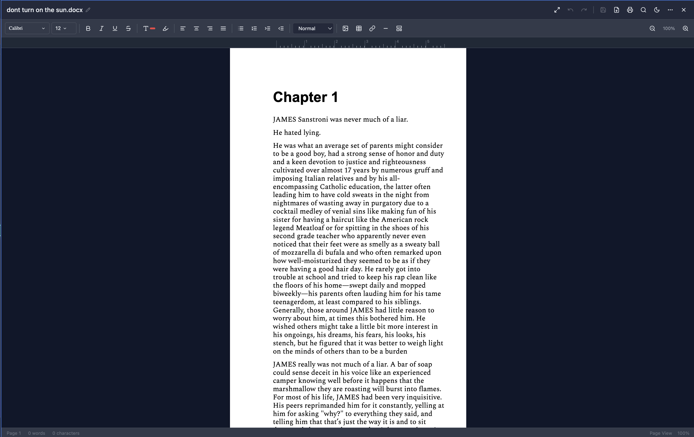

**Spreadsheets (XLSX & CSV)** - Edit data with formula support and cell formatting:

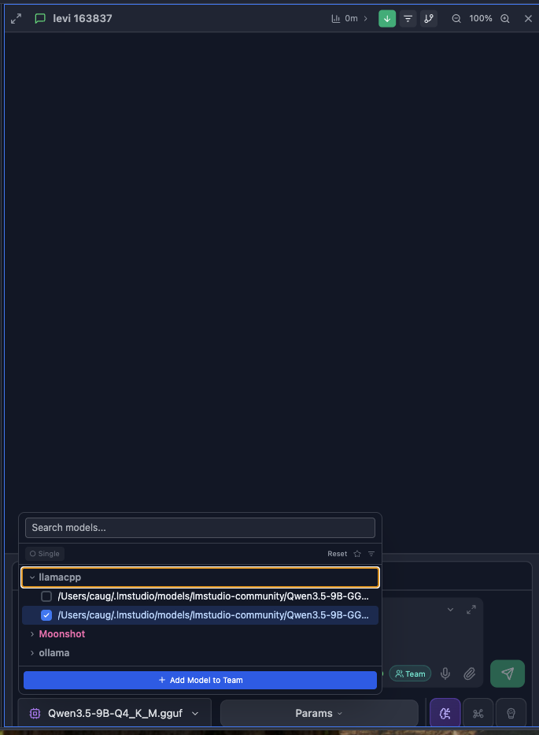

**Presentations (PPTX)** - View and edit PowerPoint presentations:

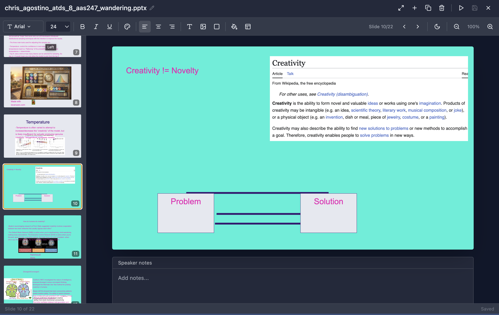

### PDF Management

Read, annotate, and analyze PDF documents with AI assistance.

**Highlight & Annotate** - Mark up PDFs with highlights that persist across sessions:

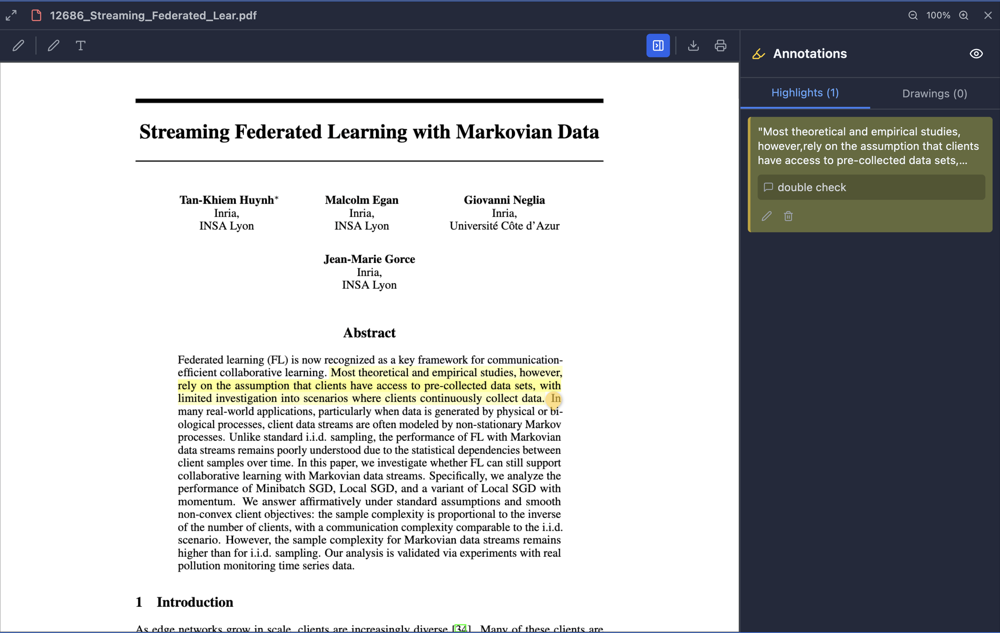


### File Management

**Folder Explorer** - Drag any folder from the sidebar into a pane to open a dedicated file browser:

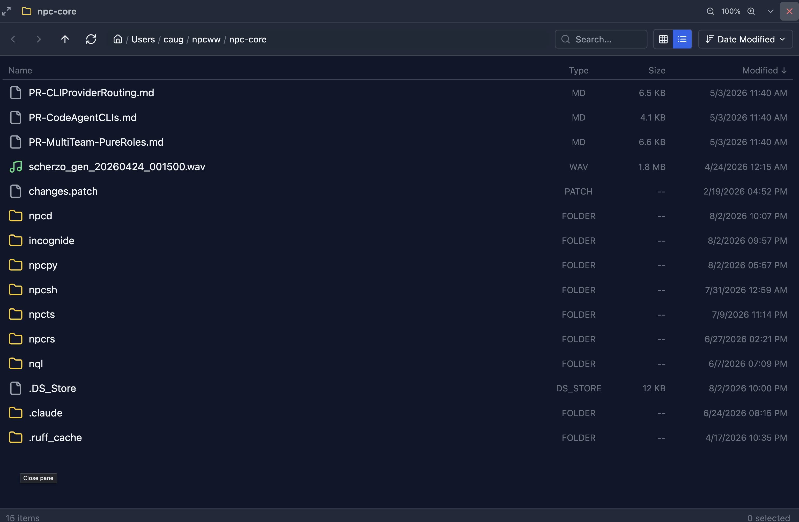

**Disk Usage Analyzer** - Visualize what's taking up space on your drives:

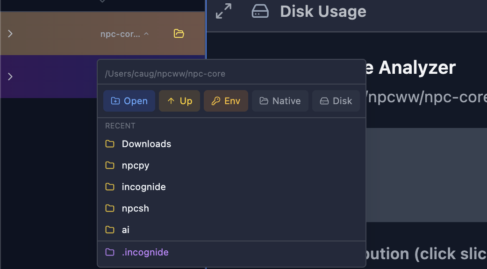
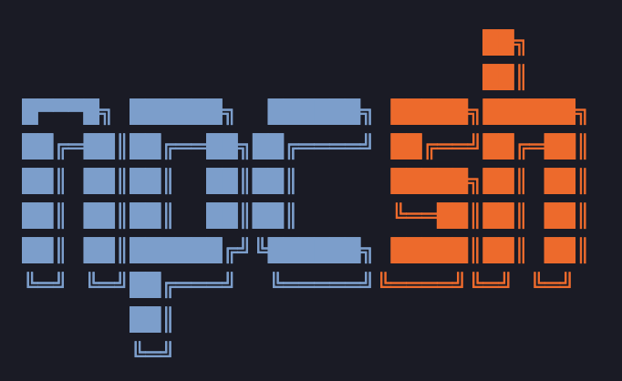

### Web Browsing

Browse the web alongside your documents and chat with AI about what you're viewing.

**Integrated Browser** - No need to switch to a separate browser window:

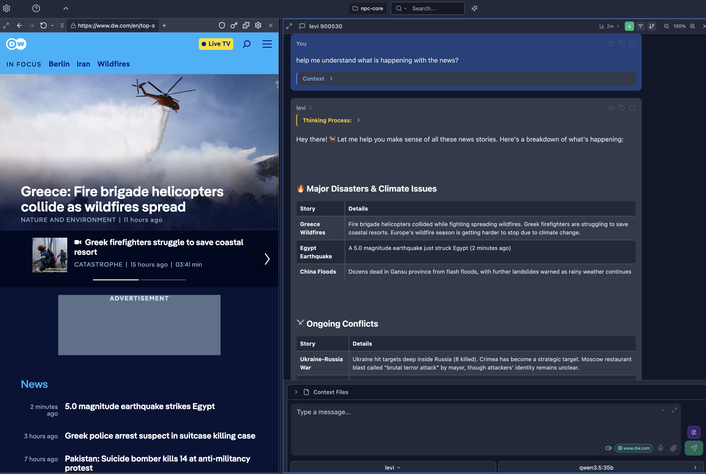

---

## Development

### Code Editing

Write code with syntax highlighting, run scripts, and compile documents.

**Code Editor and script execution** - Syntax highlighting for Python, JavaScript, TypeScript, and more. Vim, Emacs, and Nano keybinding modes with a toggleable cheat sheet. Run Python scripts directly and see output inline:

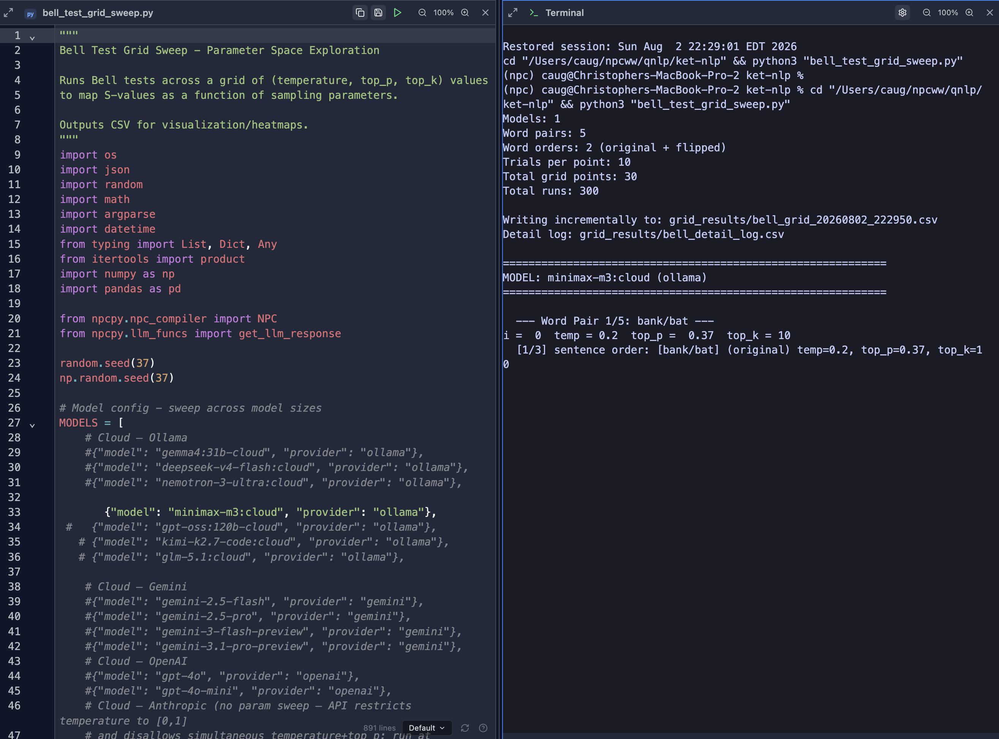

**LaTeX Compilation** - Write and compile LaTeX documents with PDF generation launching a pane.

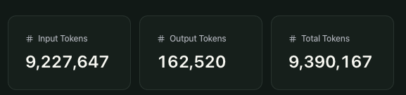


### Git Integration

**Git Manager** - Stage, commit, and manage branches without leaving Incognide:

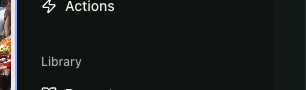

---


## STL Viewer

View 3D models directly in Incognide.

*Features:*
- Orbit, pan, and zoom with mouse controls
- Wireframe, axes, and grid toggles in the pane header
- Quick axis views (X, Y, Z) for front/side/top perspectives
- Adjustable mesh color and opacity
- Screenshot export of the current viewport
- Model info: triangle count, vertex count, and bounding box dimensions

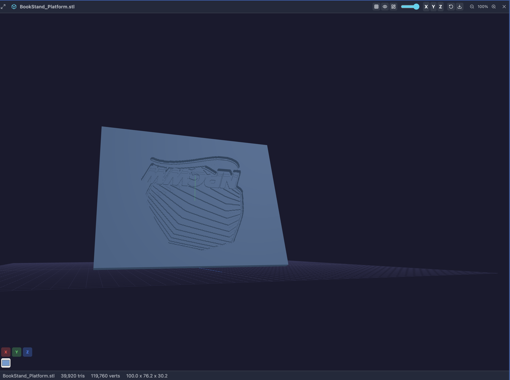


### Cloud Sync & Account

**Sign In** - Create an account to sync your conversations and settings.

**End-to-End Encryption** - All synced data is encrypted with your passphrase before leaving your device. Your passphrase never leaves your machine.

### macOS Permissions

On macOS, manage permissions for camera, microphone, and screen capture from Settings. Required for voice input and screenshot features.


---

## Development Setup

Incognide is an Electron + React frontend with a Python Flask backend powered by [npcpy](https://github.com/npc-worldwide/npcpy). The UI uses [npcts](https://github.com/npc-worldwide/npcts), a React component library.

### Prerequisites

- [npcpy](https://github.com/npc-worldwide/npcpy) - Core Python library
- [npcts](https://github.com/npc-worldwide/npcts) - React component library (installed via npm)
- Node.js 16+ and npm
- Ollama (optional, for local models)

### Setup

**Option 1: Manual setup**
```bash
git clone https://github.com/npc-worldwide/incognide.git
cd incognide
npm install
```

**Option 2: Via npcsh** (installs to `~/.incognide`)
```bash
npcsh> /incognidev
```

### Running

```bash
python incognide_serve.py   # Backend
npm run dev                   # Frontend (Vite)
npm start                     # Electron
```

---

## Community

- **Discord**: [Join us](https://discord.gg/XrjTFmDAna)
- **Issues & Bugs**: [GitHub Issues](https://github.com/npc-worldwide/incognide/issues)
- **Discussions**: [GitHub Discussions](https://github.com/npc-worldwide/incognide/discussions)
- **NPC Ecosystem**: [npcpy](https://github.com/npc-worldwide/npcpy) | [npcsh](https://github.com/npc-worldwide/npcsh) | [npcts](https://github.com/npc-worldwide/npcts)

---

## License

Incognide is licensed under the MIT License. See the [LICENSE](LICENSE) file for details.
